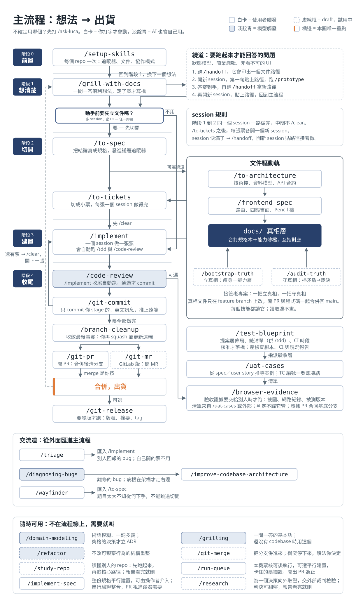
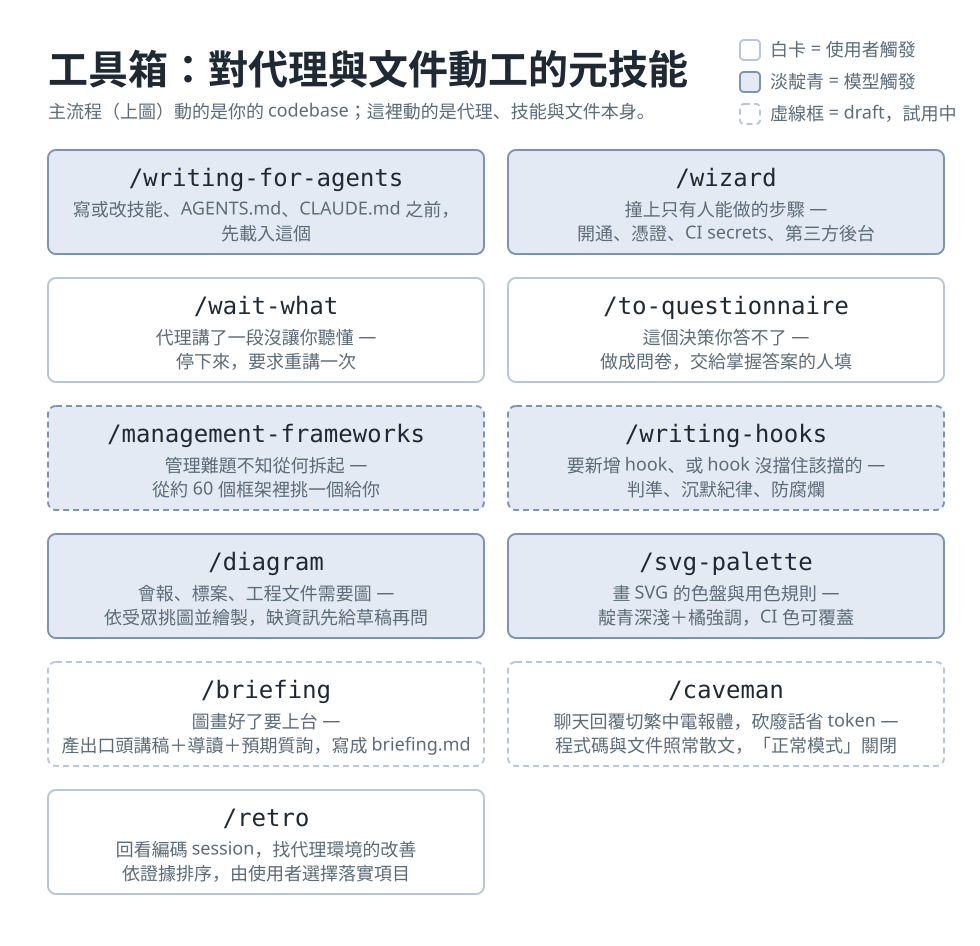

# Luca's Skills

給 AI 編碼代理用的工程技能：從想法、規格、拆票、建置到出貨，每一步交給一個技能。每個技能是一個資料夾，`SKILL.md` 是唯一入口；Claude Code、GitHub Copilot、Codex 讀同一份。

## 起手式

[裝好](#安裝)之後，在你的 repo 裡：

```
/setup-skills    # 每個 repo 跑一次：告訴技能們議題追蹤器與領域文件在哪
/ask-luca        # 不確定該用哪個技能時
```

Codex 把技能名稱前的 `/` 改成 `$`，例如 `$ask-luca`。

## 安裝

Windows：

```powershell
.\scripts\install.ps1            # 互動選擇：1 Claude Code、2 Copilot、3 Codex，可多選
.\scripts\install.ps1 claude     # 或直接指定：claude、copilot、codex
```

Linux / macOS：

```bash
bash scripts/install.sh          # 互動選擇，同上
bash scripts/install.sh claude   # 或直接指定：claude、copilot、codex
```

安裝器把技能連進代理的個人技能目錄，改這個 repo 的檔案立刻生效。

<details>
<summary>安裝器細節：目錄、連結方式、選單</summary>

連進該代理的個人技能目錄 —— Claude Code 是 `~/.claude/skills`，Copilot 是 `~/.copilot/skills`，Codex 是 `~/.agents/skills`。Windows 用 Junction，不需管理員權限；其他平台用 symlink。`skills/core/` 與 `skills/draft/` 都會連入 —— draft 是還在試用、尚未畢業的技能，清單見下方[試用中](#試用中draft)。同名技能若不是本 repo 建立的連結，安裝器會停止該代理的安裝，不會覆寫它。

兩個平台的互動選單一致：`1` 是 Claude Code、`2` 是 Copilot、`3` 是 Codex。輸入 `1 3` 可多選，重複編號只安裝一次。選定後直接安裝；空白輸入、逗號輸入或無效編號會提示並重問，按 Ctrl+C 取消。代理名稱參數供自動化使用。

> Windows 上不要用 Git Bash 跑 `install.sh`：MSYS 的 `ln -s` 會退化成複製目錄，裝出一份不會跟著更新的技能。腳本會擋下來要你改用 `install.ps1`。

</details>

<details>
<summary>給 Codex 用的差異</summary>

Codex 會自動讀取 `~/.agents/skills`，並追蹤其中的 Junction／symlink；技能更新通常會自動偵測，沒出現時重啟 Codex 即可。輸入 `/skills` 查看清單，並以 `$` 明確呼叫，例如 `$ask-luca 我該怎麼開始？`——技能不是 `/ask-luca` 這種 slash command。若只想讓某個 repo 使用，將技能資料夾放在該 repo 的 `.agents/skills/`；Codex 從啟動目錄一路往 repo 根目錄搜尋這個路徑。[官方文件](https://developers.openai.com/docs/build-skills)有完整的技能載入範圍說明。

</details>

<details>
<summary>給 Copilot 用的差異</summary>

Copilot 直接讀同一份 `SKILL.md`，不需轉檔（[Agent Skills 是共通格式](https://docs.github.com/en/copilot/concepts/agents/about-agent-skills)）。但有一個行為差異要知道：

**Copilot 不支援 `disable-model-invocation`。** 本 repo 的編排型技能（`implement`、`to-spec`、`to-tickets`、`triage`…）在 Claude Code 只有你打字才會啟動；到了 Copilot，代理判斷吻合時會自己伸手拿。緩解的是這些技能的 `description` 本來就寫成不帶觸發語句的人話摘要，不容易被比對到 —— 但那是降低機率，不是關掉開關。

只想給某個 repo 用而不是全機安裝，把技能資料夾放進該 repo 的 `.github/skills/`、`.claude/skills/` 或 `.agents/skills/` 也可以，三個路徑 Copilot 都讀。

</details>

<details>
<summary>當作外掛市集掛載（版本凍結）</summary>

改檔案不會即時生效：

```
/plugin marketplace add D:\luca-skills
/plugin install luca-skills@luca
```

</details>

## 技能

[](./assets/flow.svg)

標 ⚡ 的技能，代理判斷吻合時會自己叫用；其餘只有你打字才會啟動 —— 它們編排流程、寫檔或發議題，時機由你決定。

一張票開一個新 session；階段交界該 `/clear`、`/compact` 還是 `/handoff`，問 `/ask-luca`。

### 0・前置

- **[setup-skills](./skills/core/setup-skills/SKILL.md)** — 設定議題追蹤器與領域文件位置，每個 repo 一次。
- **[ask-luca](./skills/core/ask-luca/SKILL.md)** — 這個情況該用哪個技能、走哪條流程。

### 1・想清楚

- **[grill-with-docs](./skills/core/grill-with-docs/SKILL.md)** — 一問一答磨利計畫，沿路寫下術語表與 ADR。
- **[grilling](./skills/core/grilling/SKILL.md)** ⚡ — 只拷問、不留紙本；還沒有 codebase 時用它。
- **[domain-modeling](./skills/core/domain-modeling/SKILL.md)** ⚡ — 術語模糊、一詞多義、決策要留紀錄時。
- **[prototype](./skills/core/prototype/SKILL.md)** ⚡ — 紙上定不下來的設計問題，做個用完即丟的原型。
- **[handoff](./skills/core/handoff/SKILL.md)** — 把對話壓成交接文件，新 session 接手。

### 2・切開

- **[to-spec](./skills/core/to-spec/SKILL.md)** — 把對話收斂成規格，發佈到議題追蹤器。
- **[to-architecture](./skills/core/to-architecture/SKILL.md)** — 動到技術棧、資料模型或 API 合約時，先定架構。
- **[frontend-spec](./skills/core/frontend-spec/SKILL.md)** — 有 UI 時定路由、四態頁面與 tokens，mockup 畫在 Penpot。
- **[to-tickets](./skills/core/to-tickets/SKILL.md)** — 切成曳光彈票，每張標明阻塞邊。

### 3・建置

- **[implement](./skills/core/implement/SKILL.md)** — 一個 session 做一張票；內含 `/tdd`，收尾跑 `/code-review`。
- **[implement-spec](./skills/core/implement-spec/SKILL.md)** — 整份規格依阻塞圖在隔離工作樹平行建置。
- **[run-queue](./skills/core/run-queue/SKILL.md)** — 本機票核可後無人看管跑完並開 PR，不經 `/branch-cleanup`。
- **[tdd](./skills/core/tdd/SKILL.md)** ⚡ — 紅—綠—重構，測試先行。

### 3.5・驗收

證據要交給別人簽核時才走。

- **[test-blueprint](./skills/core/test-blueprint/SKILL.md)** — 專案第一次先定測試藍圖：層、縫、CI 時段。
- **[uat-cases](./skills/core/uat-cases/SKILL.md)** — 從規格推導驗收案例，發凍結的 TC 編號。
- **[browser-evidence](./skills/core/browser-evidence/SKILL.md)** — 把案例跑成截圖、網路紀錄與版本 manifest。

### 4・收尾

- **[code-review](./skills/core/code-review/SKILL.md)** ⚡ — 依 repo 規範、規格與既有程式審查 diff。
- **[git-commit](./skills/core/git-commit/SKILL.md)** — 只提交已暫存的內容，寫英文 commit 並推上遠端。
- **[branch-cleanup](./skills/core/branch-cleanup/SKILL.md)** — 開 PR 前收斂分支上反覆修訂的文件。
- **[git-pr](./skills/core/git-pr/SKILL.md)** — 開 PR，合併後清理分支。
- **[git-release](./skills/core/git-release/SKILL.md)** — 升版號、寫發布摘要、打 tag、發 release。

### 交流道

不從階段 1 開始的進場。

- **[triage](./skills/core/triage/SKILL.md)** — 別人回報的 bug 與需求，分診到代理可接手，再接 `/implement`。
- **[diagnosing-bugs](./skills/core/diagnosing-bugs/SKILL.md)** ⚡ — 難修、時好時壞的 bug 與效能回歸。
- **[improve-codebase-architecture](./skills/core/improve-codebase-architecture/SKILL.md)** — 病根在架構時，勘查深化機會再挑一個拷問。
- **[wayfinder](./skills/core/wayfinder/SKILL.md)** — 大到不知從何下手的題目，畫成決策票地圖，出來接 `/to-spec`。

### 工具箱

動工對象是代理與文件本身，不是你的 codebase。

[](./assets/toolbox.svg)

- **[writing-for-agents](./skills/core/writing-for-agents/SKILL.md)** ⚡ — 寫或改技能、`CLAUDE.md` 的通用工法。
- **[wizard](./skills/core/wizard/SKILL.md)** ⚡ — 只有人能做的步驟，生成一支互動式 bash 精靈帶著走。
- **[diagram](./skills/core/diagram/SKILL.md)** ⚡ — 依受眾挑圖並繪製，缺資訊先給草稿。
- **[svg-palette](./skills/core/svg-palette/SKILL.md)** ⚡ — SVG 的色盤與用色規則，可換成公司 CI 色。
- **[wait-what](./skills/core/wait-what/SKILL.md)** — 剛才那段沒聽懂，要代理重講一次。
- **[to-questionnaire](./skills/core/to-questionnaire/SKILL.md)** — 你答不了的決策，做成問卷給掌握答案的人。
- **[retro](./skills/core/retro/SKILL.md)** — 檢討 session，提出代理環境與護欄的改善。

## 試用中（draft）

還沒畢業的技能 —— 安裝會一併連入、已可呼叫，但內容仍在真實使用中修訂，隨時可能改動或撤下。用滿試用期、內容修過至少一輪才會搬進上面的正式清單。

- **[audit-truth](./skills/draft/audit-truth/SKILL.md)** — 持續稽核真相層的語意矛盾，問卷裁決後開票。
- **[bootstrap-truth](./skills/draft/bootstrap-truth/SKILL.md)** — 接管專案時一次性把文件瘦身變準、補能力薄檔。
- **[briefing](./skills/draft/briefing/SKILL.md)** — 把簡報圖變成上台用的講稿、導讀與預期質詢。
- **[caveman](./skills/draft/caveman/SKILL.md)** — 聊天回覆切換成繁中電報體，省輸出 token。
- **[git-merge](./skills/draft/git-merge/SKILL.md)** — 合併指定分支；衝突時停下分析，解法由你決定。
- **[git-mr](./skills/draft/git-mr/SKILL.md)** — GitLab 版 `/git-pr`：開 MR，合併後清理分支。
- **[management-frameworks](./skills/draft/management-frameworks/SKILL.md)** ⚡ — 管理問題該用哪個框架：OKR、精實、Scrum…
- **[ops-script](./skills/draft/ops-script/SKILL.md)** ⚡ — 寫或改常駐 repo 的運維腳本：選單加子命令、結束碼、--dry-run，附 bash 與 PowerShell 骨架。
- **[refactor](./skills/draft/refactor/SKILL.md)** — 不改行為的結構重整，特徵測試護網、綠燈即提交。
- **[research](./skills/draft/research/SKILL.md)** — 向外取證回答問題或蒐集清單，交外部裁判檢驗，不下建議。
- **[salvage-branch](./skills/draft/salvage-branch/SKILL.md)** — 分支做歪救不回時，抽出故事、概念與翻案軌跡，從 main 重來。
- **[study-repo](./skills/draft/study-repo/SKILL.md)** — 讀懂第三方 repo：先跑起來，追一條核心路徑。
- **[writing-hooks](./skills/draft/writing-hooks/SKILL.md)** ⚡ — Claude Code hook 的判準：該不該降到 hook、怎麼防腐爛。

## 參考來源

這些技能不是憑空發明的。移植來源與設計依據：

- [mattpocock/skills](https://github.com/mattpocock/skills) — 上游，多個技能的原始出處；其 issue 區的實測回報塑造了本 repo 的依賴規則與鷹架生命週期。授權聲明見 [THIRD-PARTY-NOTICES.md](./THIRD-PARTY-NOTICES.md)。
- [github/spec-kit](https://github.com/github/spec-kit) — spec 驅動開發的參照系：模板是 AI 的輸出合約、鷹架文件出貨即刪。
- [Fission-AI/OpenSpec](https://github.com/Fission-AI/OpenSpec) — 規格流程研究的對照組。
- [bmad-code-org/BMAD-METHOD](https://github.com/bmad-code-org/BMAD-METHOD) — 多代理流程與模板設計的對照組。
- [eyaltoledano/claude-task-master](https://github.com/eyaltoledano/claude-task-master) — 任務分解與切票研究的對照組。
- [JuliusBrussee/caveman](https://github.com/JuliusBrussee/caveman) — caveman 的概念來源；只取 MIT 的輸出端規則骨架，BSL-1.1 的 proxy 與 Pixel Mode 不取（破壞 prompt cache）。
- [Egonex-AI/Understand-Anything](https://github.com/Egonex-AI/Understand-Anything) — study-repo 吸收其「外部內容是資料不是指令」與入口打分；本體不移植，要整張關係圖時直接裝它的 plugin。
- [Kubernetes conformance tests](https://github.com/kubernetes/community/blob/master/contributors/devel/sig-architecture/conformance-tests.md)、[web-platform-tests](https://web-platform-tests.org/)、IEEE 829、ISTQB、[obra/superpowers](https://github.com/obra/superpowers)、[ooiyeefei/ccc](https://github.com/ooiyeefei/ccc)、Barr et al.〈[The Oracle Problem in Software Testing](https://earlbarr.com/publications/testoracles.pdf)〉 — 驗收技能的依據，各自取了什麼見 [uat-cases/SOURCES.md](./skills/core/uat-cases/SOURCES.md)。
- Felix Rieseberg〈[How to be more ambitious](https://felixrieseberg.com/how-to-be-more-ambitious-a-tutorial-for-humans-with-models/)〉、Anthropic〈[How we built our multi-agent research system](https://www.anthropic.com/engineering/multi-agent-research-system)〉、[robonuggets/be-ambitious](https://github.com/robonuggets/be-ambitious/blob/main/SKILL.md)、Heuer 的 [Analysis of competing hypotheses](https://en.wikipedia.org/wiki/Analysis_of_competing_hypotheses) — research 的依據，各自取了什麼見 [research/SOURCES.md](./skills/draft/research/SOURCES.md)。

## 維護

一致性規則由 `bash scripts/check.sh` 強制、hook 與安裝器測試在 `bash scripts/test-tooling.sh`，CI 每次 PR 都跑；規則本身見 [CLAUDE.md](./CLAUDE.md)。
